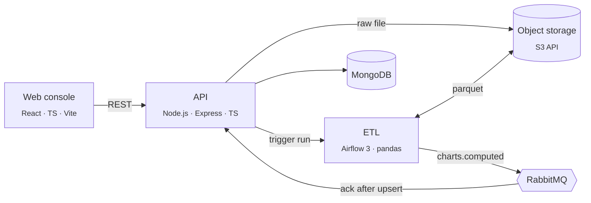

<div align="center">

# Datashelf

**Upload a dataset → run an Airflow ETL → explore the analytics dashboard.**

[](https://github.com/sink3x/datashelf-etl-app/actions/workflows/ci.yml)
[](https://sink3x.github.io/datashelf-etl-app/)
[](https://github.com/sink3x/datashelf-etl-app/releases)
[](LICENSE)


[**Live demo**](https://sink3x.github.io/datashelf-etl-app/) · [Architecture](docs/architecture.md) ·
[Stack](docs/stack.md) · [ADRs](docs/adr/README.md) · [Runbook](docs/runbook.md)

</div>

---

## What it does

1. An analyst uploads a retail transactions file (CSV/JSON) in the **web console**.
2. The **API** validates it, stores it in object storage and triggers an **Airflow** DAG run.
3. The **ETL** normalizes the data into parquet, runs a set of analytics in parallel and publishes each result
   as a versioned `dataset.charts.computed` event to **RabbitMQ**.
4. The API consumes the events idempotently into **MongoDB**; the dashboard renders metrics, time series, maps
   and word clouds.

The live demo runs the console against a mocked API (MSW), so it works without any backend.

## Architecture



More diagrams (containers, sequence, DAG) and the reliability design are in
[docs/architecture.md](docs/architecture.md).

## Stack at a glance

| Layer          | Technology                                                                 | Where                |
| -------------- | -------------------------------------------------------------------------- | -------------------- |
| Frontend       | React 19, TypeScript, Vite, MobX, Ant Design / Gravity UI, MSW, Vitest     | `apps/web`           |
| Backend        | Node.js 22, Express 5, TypeScript, zod, pino, Mongoose, amqplib, Vitest    | `apps/api`           |
| Contracts      | JSON Schema, zod, pydantic                                                 | `packages/contracts` |
| ETL            | Python 3.12, Airflow 3 TaskFlow, pandas, pyarrow, uv, ruff, mypy, pytest   | `services/etl`       |
| Research       | Jupyter, conda                                                             | `research`           |
| Data           | MongoDB, RabbitMQ, PostgreSQL (Airflow), S3 (RustFS locally)               | `docker-compose.yml` |
| Infrastructure | Terraform, Yandex Cloud (VPC, Compute COI, Object Storage, CR, Lockbox)    | `infra/terraform`    |
| Delivery       | Docker, GitHub Actions, GHCR, GitHub Pages, git flow, Conventional Commits | `.github/workflows`  |

Detailed breakdown with the reasoning behind each choice: [docs/stack.md](docs/stack.md).

## Quick start

Requirements: Docker, GNU Make. For development also Node.js 22 + pnpm (via `corepack enable`) and
[uv](https://docs.astral.sh/uv/).

```bash
git clone https://github.com/sink3x/datashelf-etl-app.git && cd datashelf-etl-app
make up       # builds images and starts the whole stack with local mocks
make smoke    # uploads a generated dataset and waits until charts are stored
```

| Service       | URL                        |
| ------------- | -------------------------- |
| Web console   | http://localhost:3000      |
| API + Swagger | http://localhost:5000/docs |
| Airflow       | http://localhost:8080      |
| RabbitMQ      | http://localhost:15672     |

Default local credentials are in [`example.env`](example.env); `make env` copies it to `.env` for overrides.

## Development

```bash
make install     # pnpm install + uv sync
make dev         # infrastructure in docker, api and web in watch mode
make check       # lint + typecheck + tests for every package
make help        # all targets
```

| Command            | What it runs                                             |
| ------------------ | -------------------------------------------------------- |
| `make lint`        | eslint (api, web), ruff (etl)                            |
| `make typecheck`   | tsc (contracts, api, web), mypy (etl)                    |
| `make test`        | vitest (contracts, api, web), pytest with coverage (etl) |
| `make images`      | production Docker images for api, web and etl            |
| `make tf-validate` | terraform fmt/validate + tflint                          |

## Deployment

| Target        | How                                                                                             |
| ------------- | ----------------------------------------------------------------------------------------------- |
| Demo          | Every push to `main` publishes the mock-mode console to GitHub Pages                            |
| Images        | Tag `vX.Y.Z` → CI → images in GHCR + GitHub Release                                             |
| Yandex Cloud  | Release or manual run of _Deploy to Yandex Cloud_ → Terraform apply → smoke test                |
| From a laptop | `make cloud-up`, `make cloud-smoke`, `make tf-destroy` (see [infra](infra/terraform/README.md)) |

## Repository layout

```
apps/
  api/             REST API, RabbitMQ consumer, OpenAPI docs
  web/             React console, mock API for the demo
packages/
  contracts/       Event schemas shared by TypeScript and Python
services/
  etl/             Airflow DAG and analytics package
research/          Notebooks (conda) for exploration and dataset generation
infra/terraform/   Yandex Cloud infrastructure as code
scripts/           Smoke test and cloud helpers
docs/              Architecture, stack, ADRs, runbook
```

## Contributing

Git flow with Conventional Commits — see [CONTRIBUTING.md](CONTRIBUTING.md).

## License

[MIT](LICENSE)
