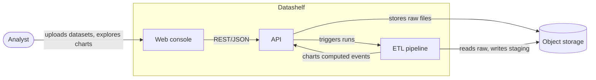
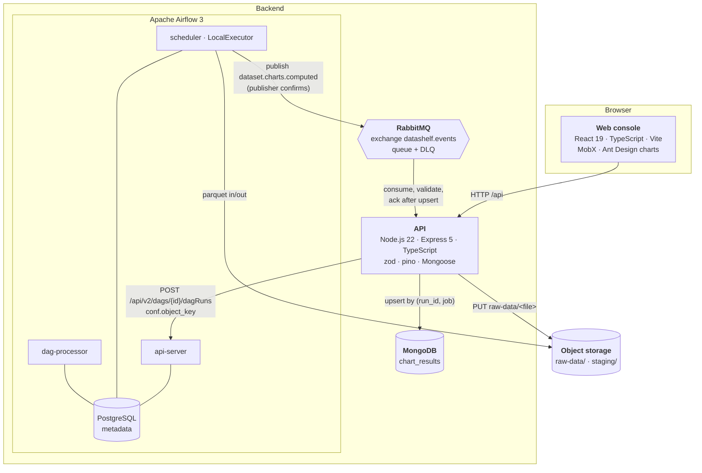
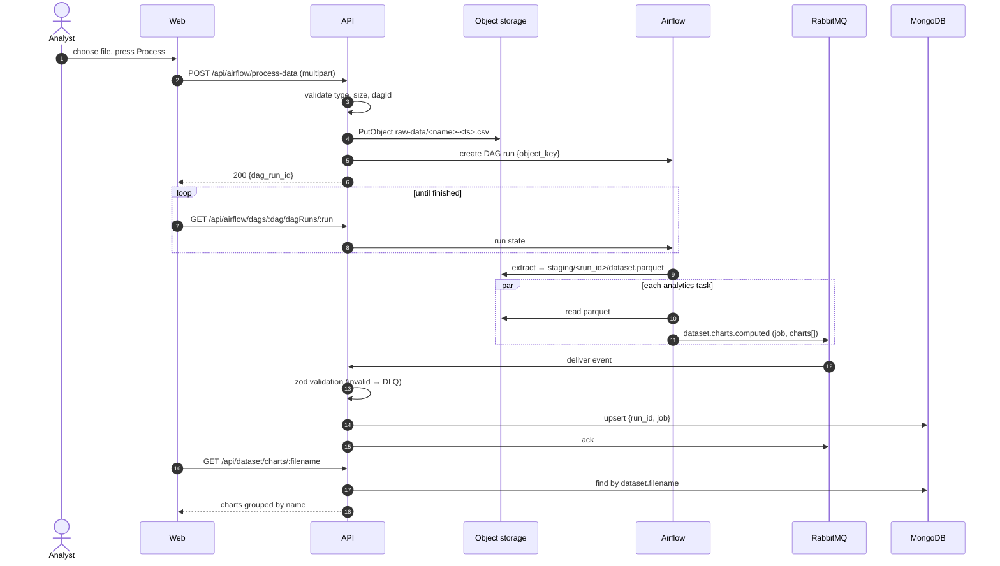
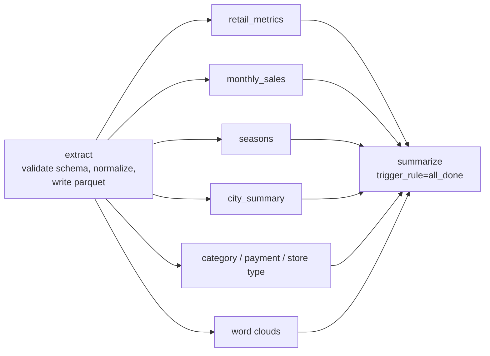

# Architecture

Datashelf turns a raw retail dataset (CSV or JSON) into an analytics dashboard. A user uploads a file in the
web console, an Airflow pipeline computes the analytics, and the dashboard renders the result in seconds.

## System context (C4 level 1)

## Containers (C4 level 2)

## Request flow

## ETL pipeline

Each analytics task is a pure `DataFrame → charts` function wrapped by a thin Airflow task, so the analytics
are unit-tested without Airflow. Tasks retry with backoff; publishing is idempotent thanks to the
`(run_id, job)` key. See [services/etl/README.md](../services/etl/README.md) for the exact task list.

## Reliability decisions

| Concern                 | Mechanism                                                                                                        |
| ----------------------- | ---------------------------------------------------------------------------------------------------------------- |
| Lost results            | Publisher confirms + `mandatory`; consumer acks only after the DB write                                          |
| Duplicates from retries | Unique index and upsert on `(run_id, job)`                                                                       |
| Malformed messages      | Schema validation, `nack(requeue=false)` → dead-letter queue                                                     |
| Large datasets          | Parquet in object storage, only keys in XCom ([ADR-0003](adr/0003-stage-intermediate-data-in-object-storage.md)) |
| Broken configuration    | Validated env at startup, process exits with a readable error                                                    |
| Dependency outages      | `/readyz` checks MongoDB, RabbitMQ and S3; consumer reconnects with backoff                                      |
| Shutdown                | SIGTERM stops consuming, drains HTTP, closes connections                                                         |

## Deployment views

| Environment  | Entry point                                | Backend                                                    | Storage          |
| ------------ | ------------------------------------------ | ---------------------------------------------------------- | ---------------- |
| Local        | web `:3000`, API `:5000`                   | docker compose: API, Airflow ×4, Postgres, Mongo, RabbitMQ | RustFS (S3 mock) |
| Demo         | GitHub Pages, mock API (MSW)               | —                                                          | —                |
| Yandex Cloud | Caddy with Let's Encrypt, one HTTPS origin | Container Optimized VM running the same compose spec       | Object Storage   |

In the cloud, Caddy routes `/api`, `/docs`, `/healthz` and `/readyz` to the API and everything else to the web
container, so the browser talks to a single origin: no CORS, no mixed content
([ADR-0007](adr/0007-single-https-origin-in-the-cloud.md)).

Infrastructure details: [infra/terraform/README.md](../infra/terraform/README.md) and
[ADR-0004](adr/0004-single-vm-for-dev-environment.md).

## Trade-offs and scaling path

The stack is sized for one analyst workload on one VM. The choices below are deliberate; each links to the ADR
that records the context.

- **RabbitMQ, not Kafka** ([ADR-0002](adr/0002-event-driven-chart-delivery-with-versioned-contract.md)).
  Results are small and consumed once, so replay is not needed and RabbitMQ is simpler to run on one VM.
  Cost: there is no durable log, so recovering lost events means re-running the DAG.
- **Events, not direct database writes.** Airflow stays unaware of the API's storage model and credentials.
  Cost: a schema change needs a new `schema_version` and a migration window on the consumer.
- **MongoDB for chart results.** Charts are schemaless documents keyed by `(run_id, job)`, and an upsert on
  that key gives idempotency. Cost: no joins or cross-run SQL analytics; a relational store would suit ad-hoc
  reporting better.
- **Parquet in S3, only keys in XCom** ([ADR-0003](adr/0003-stage-intermediate-data-in-object-storage.md)).
  The Airflow metadata database stays small. Cost: every task needs S3 access and staged files need a
  lifecycle rule.
- **One VM for the dev cloud** ([ADR-0004](adr/0004-single-vm-for-dev-environment.md)). The environment is
  created or destroyed in minutes at minimal cost. Cost: single point of failure, no horizontal scaling, state
  is lost on destroy.
- **One HTTPS origin behind Caddy** ([ADR-0007](adr/0007-single-https-origin-in-the-cloud.md)). No CORS and no
  mixed content. Cost: the console shares the VM's availability and depends on sslip.io unless a domain is set.

### If the load grows

This is an analysis of where the design would bend first, not a benchmark result.

1. **Dataset size.** The extract task loads a dataset into worker memory, so RAM per task is the first limit.
   Next steps: chunked reads with pyarrow, or Airflow workers sized per task.
2. **Throughput.** The API consumer is a single process. Run several replicas on the same queue; the
   `(run_id, job)` upsert already makes concurrent consumers safe.
3. **Replay and audit.** If events must be replayed or consumed by other services, replace the exchange with
   a Kafka topic; the versioned contract in `packages/contracts` stays as is.
4. **Availability.** Move to the production path from ADR-0004: managed databases, Serverless Containers or
   Kubernetes for the API and Airflow workers, and ALB with Certificate Manager for TLS.
