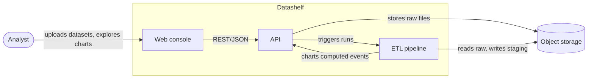
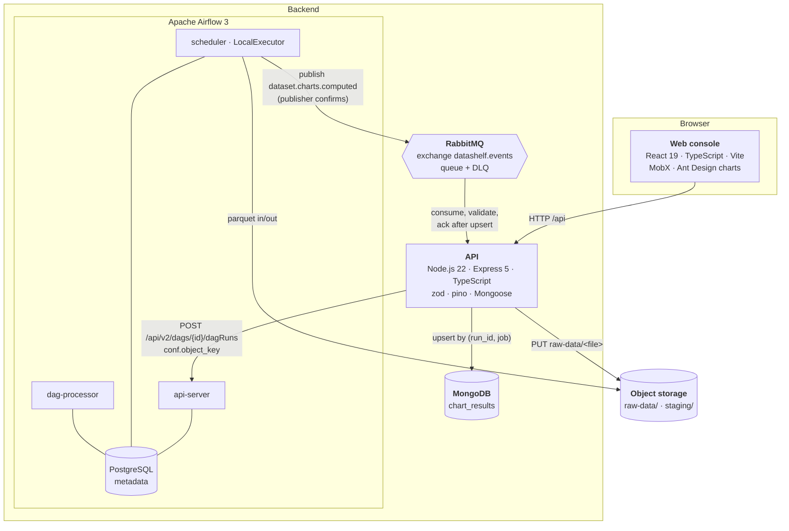
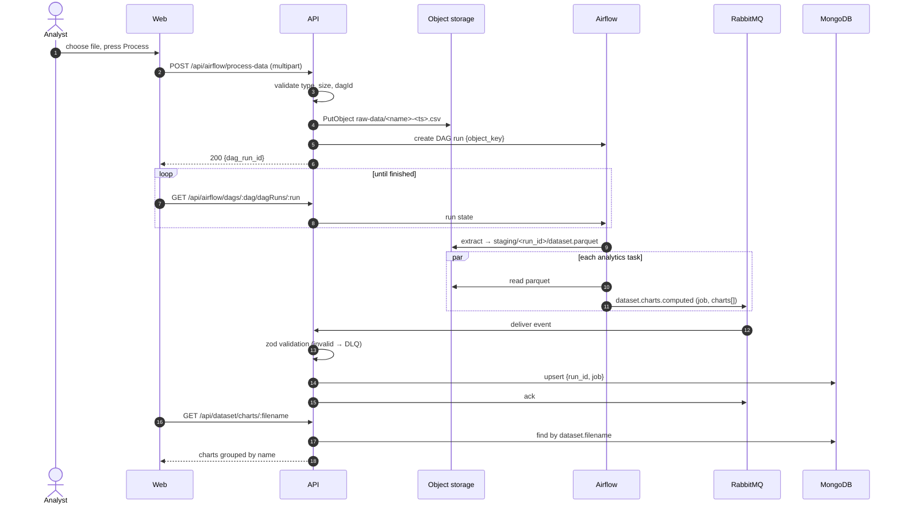
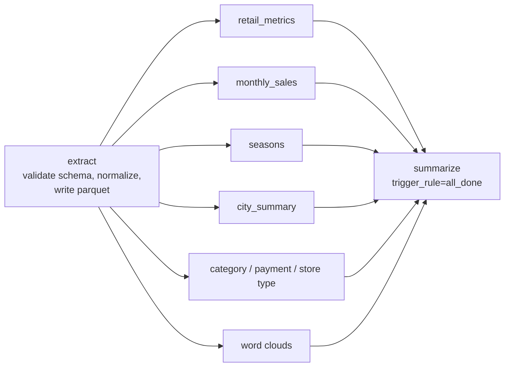

# Architecture

Datashelf turns a raw retail dataset (CSV or JSON) into an analytics dashboard. A user uploads a file in the
web console, an Airflow pipeline computes the analytics, and the dashboard renders the result in seconds.

## System context (C4 level 1)

## Containers (C4 level 2)

## Request flow

## ETL pipeline

Each analytics task is a pure `DataFrame → charts` function wrapped by a thin Airflow task, so the analytics
are unit-tested without Airflow. Tasks retry with backoff; publishing is idempotent thanks to the
`(run_id, job)` key. See [services/etl/README.md](../services/etl/README.md) for the exact task list.

## Reliability decisions

| Concern                 | Mechanism                                                                                                        |
| ----------------------- | ---------------------------------------------------------------------------------------------------------------- |
| Lost results            | Publisher confirms + `mandatory`; consumer acks only after the DB write                                          |
| Duplicates from retries | Unique index and upsert on `(run_id, job)`                                                                       |
| Malformed messages      | Schema validation, `nack(requeue=false)` → dead-letter queue                                                     |
| Large datasets          | Parquet in object storage, only keys in XCom ([ADR-0003](adr/0003-stage-intermediate-data-in-object-storage.md)) |
| Broken configuration    | Validated env at startup, process exits with a readable error                                                    |
| Dependency outages      | `/readyz` checks MongoDB, RabbitMQ and S3; consumer reconnects with backoff                                      |
| Shutdown                | SIGTERM stops consuming, drains HTTP, closes connections                                                         |

## Deployment views

| Environment  | Entry point                                | Backend                                                    | Storage          |
| ------------ | ------------------------------------------ | ---------------------------------------------------------- | ---------------- |
| Local        | web `:3000`, API `:5000`                   | docker compose: API, Airflow ×4, Postgres, Mongo, RabbitMQ | RustFS (S3 mock) |
| Demo         | GitHub Pages, mock API (MSW)               | —                                                          | —                |
| Yandex Cloud | Caddy with Let's Encrypt, one HTTPS origin | Container Optimized VM running the same compose spec       | Object Storage   |

In the cloud, Caddy routes `/api`, `/docs`, `/healthz` and `/readyz` to the API and everything else to the web
container, so the browser talks to a single origin: no CORS, no mixed content
([ADR-0007](adr/0007-single-https-origin-in-the-cloud.md)).

Infrastructure details: [infra/terraform/README.md](../infra/terraform/README.md) and
[ADR-0004](adr/0004-single-vm-for-dev-environment.md).
